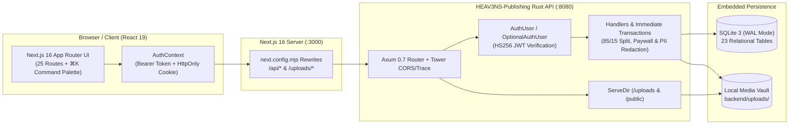

<div align="center">

# HEAV3NS-Publishing

**An open-source, high-performance creator monetization platform built with Rust (Axum + SQLite WAL) and Next.js 16 (React 19 + TypeScript).**

[](https://github.com/CardSorting/HEAV3NS-PUBLISHING/actions/workflows/ci.yml)
[](./backend/)
[-black?logo=next.js)](./frontend/)
[](./frontend/)
[](./docs/architecture/database-schema.md)
[](./LICENSE)
[](./CONTRIBUTING.md)

[Quick Start](#-quick-start) · [Architecture](#-system-architecture) · [Features](#-feature-matrix) · [Documentation & Knowledge Base](./docs/README.md) · [ADRs](./docs/README.md#2-architecture-decision-records-adrs) · [Playbooks](./docs/README.md#3-operational-playbooks--runbooks) · [Post-Mortems](./docs/README.md#4-engineering-post-mortems) · [Contributing](./CONTRIBUTING.md)

</div>

---

## 📖 Overview

**HEAV3NS-Publishing** is a full-stack creator economy and content monetization platform engineered for speed, cryptographic paywall integrity, and zero-dependency deployment.

It is architected as a modern two-tier stack:
1. **Rust Backend (`backend/`)**: A memory-safe **Axum 0.7 + Tokio** HTTP server backed by embedded **SQLite in Write-Ahead Logging (WAL)** mode (`rusqlite`), enforcing server-side paywall redaction, PII masking, and `BEGIN IMMEDIATE` financial ledger transactions across 23 relational tables and 60+ REST endpoints.
2. **Next.js 16 Frontend (`frontend/`)**: A responsive **Next.js 16.4.3 (App Router + Turbopack) + React 19.3.1 + TypeScript** web application featuring a global `⌘K` Command Palette, dark/light theme persistence, real-time creator feeds, short-form Reels, 24h Stories, HLS Live Streaming, and a 1-on-1 & broadcast Direct Messenger.

---

## 📑 Table of Contents

- [System Architecture](#-system-architecture)
- [Feature Matrix](#-feature-matrix)
- [Quick Start](#-quick-start)
- [Demo Accounts](#-demo-accounts)
- [Configuration & Environment Variables](#-configuration--environment-variables)
- [Testing, Linting & Verification](#-testing-linting--verification)
- [Engineering Knowledge Base (`docs/`)](#-engineering-knowledge-base-docs)
- [Open-Source Governance & Community](#-open-source-governance--community)
- [License](#-license)

---

## 🏗️ System Architecture



| Layer | Technology Stack | Directory | Default URL |
| :--- | :--- | :--- | :--- |
| **Backend API** | Rust 2021, Axum 0.7, Tokio, `rusqlite` (bundled SQLite WAL), Bcrypt, `jsonwebtoken` (HS256), Tower HTTP | [`backend/`](./backend/) | `http://127.0.0.1:8080` |
| **Frontend Web** | Next.js 16.4.3 (App Router + Turbopack), React 19.3.1, TypeScript 5.6, Bootstrap 5 (Light & Dark themes) | [`frontend/`](./frontend/) | `http://127.0.0.1:3000` |
| **Docs & Knowledge Base** | System Architecture, 23-Table Schema, REST API Reference, 5 ADRs, 5 Playbooks, 4 Post-Mortems | [`docs/`](./docs/README.md) | — |

---

## ✨ Feature Matrix

| Domain | Capabilities Implemented |
| :--- | :--- |
| **🔐 Authentication & Privacy** | Dual-channel JWT auth (`Authorization: Bearer` + `HttpOnly` cookie), role-based Admin access (`role_id = 1`), 2FA/geoblocking settings, bidirectional user blocking (`is_blocked_between`), and strict server-side PII masking (`email`, `wallet_balance`, `birthdate`, and billing address fields are hidden from non-owners). |
| **📰 Creator Feed & Paywalls** | Subscription-gated and Pay-Per-View (PPV) posts; server-side redaction of locked text, comments, polls, and attachment URLs; scheduled (`release_date`) and expiring (`expire_date`) posts; pinned posts; interactive multi-option polls; post & comment reactions; bookmarks. |
| **🎬 Short-Form Reels & 24h Stories** | Vertical video Reels (`/reels`) with `<video>` playback, PPV reel unlocks (`reel-unlock`), Media Vault video selection, likes, comments drawer, and bookmarks. Ephemeral 24h Stories with permanent creator Profile Highlights (`is_highlight`) and viewer analytics (`story_views`). |
| **🔴 Live Streaming** | Creator streaming studio (`/my/streams`), RTMP key management (masked for non-owners), HLS `<video>` playback (`/stream/[streamID]/[slug]`), real-time live stream chat (`stream_messages`), and VIP / PPV stream ticket unlocks (`stream-unlock`). |
| **💬 Direct & Broadcast Messenger** | 1-on-1 creator-fan messaging (`/my/messenger`), paid PPV locked messages (`message-unlock`), in-chat tips (`chat-tip`), Media Vault attachments, and multi-recipient / fan-list mass broadcast messaging. |
| **💳 Wallet, Offers & Payouts** | Unified payment ledger (`POST /api/payments/initiate`) with `BEGIN IMMEDIATE` ACID transactions, 85% creator / 15% platform revenue split, 1/3/6/12-month subscription bundles, promotional creator discount campaigns (`creator_offers`), referral bonuses (`referrals`), printable tax invoices (`/invoices/[id]`), and creator withdrawal escrow with automatic refund on rejection. |
| **🧭 World-Class UX & Command Palette** | Global `⌘K` / `Ctrl+K` Command Palette for instant navigation, theme switching, quick creation, and Explore search; sticky contextual header breadcrumbs; unread notification/message badges; mobile bottom navigation bar. |
| **🛡️ Trust, Safety & Admin** | Creator KYC Identity Verification upload (`user_verifies`), user/post/stream abuse reporting (`user_reports`), and Admin Moderation Dashboard (`/admin`) for platform metrics, withdrawal payouts, KYC approvals, and report resolution. |

---

## 🚀 Quick Start

### Prerequisites
- **Rust**: `1.75+` (`rustup update stable`)
- **Node.js**: `v20+` and `npm`

### 1. Start the Full Stack with One Command
From the repository root:
```bash
./start-dev.sh
```
`start-dev.sh` compiles and launches the Rust backend on `http://127.0.0.1:8080` and the Next.js 16 frontend on `http://127.0.0.1:3000`, automatically initializing and seeding the SQLite database on first run.

### 2. Run Backend & Frontend Separately

**Terminal 1 — Rust Backend (`backend/`)**:
```bash
cd backend
PORT=8080 DATABASE_URL=justfans.sqlite cargo run
```

**Terminal 2 — Next.js 16 Frontend (`frontend/`)**:
```bash
cd frontend
npm install
BACKEND_URL="http://127.0.0.1:8080" npm run dev
```

Open **`http://localhost:3000`** in your browser. Press **`⌘K`** (macOS) or **`Ctrl+K`** (Windows/Linux) at any time to open the Command Palette.

---

## 👤 Demo Accounts

On initial startup, [`backend/src/db.rs`](./backend/src/db.rs) seeds 4 ready-to-use demo accounts. All accounts use the password: **`password123`**

| Persona | Name | Username | Email | Monthly Rate | Seeded Wallet |
| :--- | :--- | :--- | :--- | :--- | :--- |
| **Admin & Verified Creator** | Aria Vance | `@ariavance` | `aria@justfans.local` | `$14.99/mo` (Promo Offer Active) | `$1,450.50` |
| **Verified Creator** | Marcus Sterling | `@marcusfit` | `marcus@justfans.local` | `$9.99/mo` | `$820.00` |
| **Verified Creator (Free/Open)** | Elena Rostova | `@elenamusic` | `elena@justfans.local` | Free (`$0.00`) | `$540.75` |
| **Fan / Subscriber** | Alex Rivera | `@alexrivera` | `alex@justfans.local` | Free (`$0.00`) | `$250.00` |

---

## ⚙️ Configuration & Environment Variables

| Variable | Service | Default | Description |
| :--- | :--- | :--- | :--- |
| `PORT` | `backend` | `8080` | TCP port the Axum HTTP server binds to (`0.0.0.0:$PORT`) |
| `DATABASE_URL` | `backend` | `justfans.sqlite` | File path for the embedded SQLite WAL database (`:memory:` in tests) |
| `UPLOADS_DIR` | `backend` | `uploads` | Directory where uploaded media files are stored and served at `/uploads/*` |
| `PUBLIC_DIR` | `backend` | `../frontend/public` | Static assets directory served at `/img/*`, `/css/*`, `/fonts/*` |
| `JWT_SECRET` | `backend` | `justfans-super-secret-jwt-key-2026-rust-edition` | HMAC-SHA256 secret key used to sign and verify stateless JWTs |
| `BACKEND_URL` | `frontend` | `http://127.0.0.1:8080` | Upstream Rust API origin proxied by [`frontend/next.config.mjs`](./frontend/next.config.mjs) |

---

## 🧪 Testing, Linting & Verification

Run the automated test suites and static analysis gates before submitting a pull request:

```bash
# 1. Run all 8 end-to-end Rust integration & security test suites
cd backend && cargo test

# 2. Run strict Clippy static analysis (0 warnings allowed)
cd backend && cargo clippy --all-targets -- -D warnings

# 3. Verify Next.js 16.4.3 TypeScript & production build (25 routes)
cd frontend && npm run build
```

---

## 📚 Engineering Knowledge Base (`docs/`)

Our [`docs/`](./docs/README.md) directory contains comprehensive architecture references, ADRs, operational runbooks, and post-mortems:

- **Documentation Hub**: [`docs/README.md`](./docs/README.md)
- **Domain Reference**: [Knowledge Base & Core Invariants](./docs/knowledge-base/overview.md)
- **Architecture & Schema**:
  - [System Architecture & Data Flows](./docs/architecture/system-architecture.md)
  - [Database Schema & ER Diagram (23 Tables)](./docs/architecture/database-schema.md)
  - [Complete REST API Reference (60+ Endpoints)](./docs/api/api-reference.md)
- **Architecture Decision Records (ADRs)**:
  - [ADR-001: Decoupled Rust (Axum) & Next.js 16 Two-Tier Architecture](./docs/adr/001-rust-axum-and-nextjs-migration.md)
  - [ADR-002: Embedded SQLite with WAL Mode and Mutex-Synchronized State](./docs/adr/002-sqlite-wal-and-state-management.md)
  - [ADR-003: Dual-Channel Stateless JWT Authentication & Optional Extractor Pattern](./docs/adr/003-dual-channel-jwt-authentication.md)
  - [ADR-004: Server-Side Paywall Enforcement & Privacy Redaction at the Serialization Boundary](./docs/adr/004-server-side-paywall-and-privacy-masking.md)
  - [ADR-005: Unified Payment Ledger, Authoritative Pricing & 85/15 Creator Revenue Split](./docs/adr/005-unified-payment-ledger-and-creator-split.md)
- **Operational Playbooks**:
  - [Playbook 001: Local Development, Startup & Full-Stack Verification](./docs/playbooks/001-local-development-and-startup.md)
  - [Playbook 002: Database Backup, Restore, Inspection & Clean Re-Seeding](./docs/playbooks/002-database-backup-restore-and-seeding.md)
  - [Playbook 003: Payment, Wallet & Creator Payout Reconciliation](./docs/playbooks/003-payment-and-payout-reconciliation.md)
  - [Playbook 004: Content Moderation & Creator Identity Verification](./docs/playbooks/004-moderation-and-creator-verification.md)
  - [Playbook 005: Security Incident Response & Paywall Audit](./docs/playbooks/005-security-incident-and-paywall-audit.md)
- **Engineering Post-Mortems**:
  - [PM-001: Subscription Price Spoofing & Duplicate PPV Unlock Charges](./docs/post-mortems/001-subscription-price-spoofing-and-ppv-double-charge.md)
  - [PM-002: Locked Post Cleartext Metadata, VIP Stream HLS & Public Profile PII Exposure](./docs/post-mortems/002-locked-post-and-stream-paywall-data-leak.md)
  - [PM-003: Cross-Poll Vote Corruption & Vault Attachment Row Duplication](./docs/post-mortems/003-poll-vote-corruption-and-attachment-duplication.md)
  - [PM-004: Frontend-Backend Contract Mismatches & Pre-Filter Feed Pagination](./docs/post-mortems/004-frontend-backend-contract-and-pagination-mismatches.md)

---

## 🤝 Open-Source Governance & Community

We welcome contributions from the community! Please review our open-source governance documents:

- **[Contributing Guide (`CONTRIBUTING.md`)](./CONTRIBUTING.md)** — How to set up your environment, architectural invariants, commit conventions, and PR checklist.
- **[Code of Conduct (`CODE_OF_CONDUCT.md`)](./CODE_OF_CONDUCT.md)** — Contributor Covenant v2.1 community standards.
- **[Security Policy (`SECURITY.md`)](./SECURITY.md)** — Supported versions, security architecture highlights, and private vulnerability reporting.
- **[Changelog (`CHANGELOG.md`)](./CHANGELOG.md)** — Release history and notable changes.
- **[Support (`SUPPORT.md`)](./SUPPORT.md)** — Where to find help, runbooks, and issue templates.

---

## 📄 License

Distributed under the **MIT License**. See [`LICENSE`](./LICENSE) for full license text.
