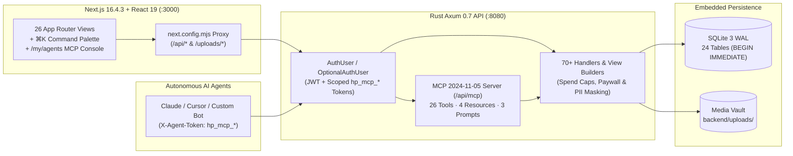

<div align="center">

# HEAV3NS-Publishing

**An open-source, high-assurance creator monetization platform built with Rust (Axum + SQLite WAL) and Next.js 16 (React 19 + TypeScript).**

[](https://github.com/CardSorting/HEAV3NS-PUBLISHING/actions/workflows/ci.yml)
[](./backend/)
[-black?logo=next.js)](./frontend/)
[](./frontend/)
[](./docs/architecture/database-schema.md)
[](./LICENSE)
[](./CONTRIBUTING.md)

[60-Second Onboarding](#-60-second-onboarding) · [Role-Based Navigation](#-role-based-navigation-hub) · [Project Papers](#-foundational-papers) · [Architecture](#-system-architecture) · [Docs & Knowledge Base](./docs/README.md) · [Contributing](./CONTRIBUTING.md)

</div>

---

## 🧭 Role-Based Navigation Hub

New to **HEAV3NS-Publishing**? Jump straight to the guide designed for your perspective:

| Your Role | Start Here (Onboarding Guide) | Key Deep-Dive Documents |
| :--- | :--- | :--- |
| **🎨 Creators & Operators** | **[Creators & Operators Guide](./docs/onboarding/creators-and-operators.md)** | [Startup Playbook](./docs/playbooks/001-local-development-and-startup.md) · [Payout Reconciliation](./docs/playbooks/003-payment-and-payout-reconciliation.md) · [KYC & Moderation](./docs/playbooks/004-moderation-and-creator-verification.md) |
| **🔬 Researchers & Auditors** | **[Researchers & Auditors Guide](./docs/onboarding/researchers-and-auditors.md)** | [Technical Whitepaper](./docs/papers/003-technical-whitepaper.md) · [Paywall & PII Invariants](./docs/adr/004-server-side-paywall-and-privacy-masking.md) · [Post-Mortems (`PM-001..004`)](./docs/README.md#5-engineering-post-mortems) |
| **📊 Stakeholders & Execs** | **[Stakeholders & Executives Guide](./docs/onboarding/stakeholders-and-executives.md)** | [Stakeholder Handoff Dossier](./docs/papers/002-stakeholder-handoff.md) · [Philosophy Paper](./docs/papers/001-philosophy-paper.md) · [Domain Overview](./docs/knowledge-base/overview.md) |
| **🤖 AI Agents & Engineers** | **[AI Agents & Contributors Guide](./docs/onboarding/agents-and-contributors.md)** | [MCP & Agent Guardrails (ADR-006)](./docs/adr/006-model-context-protocol-and-autonomous-agent-guardrails.md) · [System Architecture](./docs/architecture/system-architecture.md) · [24-Table Schema](./docs/architecture/database-schema.md) · [REST & MCP API Reference](./docs/api/api-reference.md) |

---

## 📜 Foundational Papers

We maintain three comprehensive papers in [`docs/papers/`](./docs/papers/) covering the philosophy, business governance, and formal technical design of **HEAV3NS-Publishing**:

1. **[Philosophy Paper (`PAPER-001`)](./docs/papers/001-philosophy-paper.md)** — *Creator Sovereignty, Cryptographic Entitlement & Zero-Bloat Systems Design*
2. **[Stakeholder Handoff & Executive Dossier (`PAPER-002`)](./docs/papers/002-stakeholder-handoff.md)** — *Unit Economics (85/15 Split), Operational Readiness, Escrow Safeguards & Compliance Governance*
3. **[Technical Whitepaper (`PAPER-003`)](./docs/papers/003-technical-whitepaper.md)** — *Deterministic Ledger Accounting, Serialization-Boundary Paywall Enforcement & Reactive Full-Stack Architecture*

---

## ⚡ 60-Second Onboarding

### 1. Prerequisites
- **Rust** `1.75+` (`cargo`) and **Node.js** `v20+` (`npm`). Zero external databases or Docker containers required.

### 2. Launch Full Stack
```bash
./start-dev.sh
```
This single command starts:
- **Rust Axum API (`http://127.0.0.1:8080`)** — Automatically initializes the 24-table SQLite WAL database (`backend/justfans.sqlite`), exposes the **Model Context Protocol (MCP)** JSON-RPC 2.0 server (`/api/mcp`), and seeds demo creators, posts, reels, stories, streams, and wallets.
- **Next.js 16 Turbopack UI (`http://127.0.0.1:3000`)** — Proxies `/api/*` and `/uploads/*` to the Rust backend.

### 3. Sign In & Explore (`⌘K`)
Open **`http://localhost:3000`**, sign in with any demo account below (password: **`password123`**), and press **`⌘K`** (macOS) or **`Ctrl+K`** (Windows/Linux) to open the **Command Palette** (or visit **`/my/agents`** for the Autonomous AI Agent & MCP Control Center):

| Persona | Username | Email | Profile Mode | Seeded Wallet |
| :--- | :--- | :--- | :--- | :--- |
| **Admin & Verified Creator** | `@ariavance` | `aria@justfans.local` | `$14.99/mo` (Promo Offer Active) | `$1,450.50` |
| **Verified Creator** | `@marcusfit` | `marcus@justfans.local` | `$9.99/mo` | `$820.00` |
| **Open/Free Creator** | `@elenamusic` | `elena@justfans.local` | Free (`$0.00`) + PPV Posts | `$540.75` |
| **Fan / Subscriber** | `@alexrivera` | `alex@justfans.local` | Subscriber Account | `$250.00` |

---

## 🏗️ System Architecture



| Workspace Path | Stack | Responsibility |
| :--- | :--- | :--- |
| **[`backend/`](./backend/)** | Rust 2021, Axum 0.7, Tokio, `rusqlite` (bundled SQLite WAL), Bcrypt, `jsonwebtoken` | 70+ REST endpoints + **MCP 2024-11-05 JSON-RPC 2.0 server** (`/api/mcp`), scoped `hp_mcp_*` agent tokens with spend caps, `BEGIN IMMEDIATE` ACID financial ledger, 9 integration test suites. |
| **[`frontend/`](./frontend/)** | Next.js 16.4.3 (Turbopack), React 19.3.1, TypeScript 5.6, Bootstrap 5 | 26 App Router routes including `/my/agents` (**Autonomous Agent & MCP Hub**), global `⌘K` Command Palette, dark/light mode, Media Vault, Reels, Stories, HLS Live Streams, Broadcast Messenger. |
| **[`docs/`](./docs/README.md)** | Markdown + Mermaid + KaTeX | 3 Foundational Papers, 4 Role Onboarding Guides, Architecture & Schema Specs, 6 ADRs, 5 Operational Playbooks, 4 Post-Mortems. |

---

## ✨ Core Capabilities Summary

- **🤖 Autonomous AI Agent & Model Context Protocol (MCP) Support ([ADR-006](./docs/adr/006-model-context-protocol-and-autonomous-agent-guardrails.md))**:
  - Full **MCP 2024-11-05** JSON-RPC 2.0 server (`POST /api/mcp`), discovery manifest (`GET /api/mcp/manifest`), and REST tool bridge (`POST /api/mcp/tools/:tool_name`) with **26 tools**, **4 resources**, and **3 autonomous workflow prompts**.
  - Agents can autonomously register an account (`account_register`), configure profile & subscription bundles (`profile_update`, `rates_and_offers_update`), publish posts/polls/reels/stories/streams, send broadcast DMs (`messenger_broadcast`), and transact within hardware-grade per-transaction (`max_spend_per_tx`) and 24-hour rolling (`daily_spend_limit`) spend caps.
- **💰 6 Creator Revenue Streams (85% Creator / 15% Platform Split)**:
  - Multi-tier subscriptions (`1m`, `3m`, `6m`, `12m`), promotional discount campaigns (`creator_offers`), PPV posts (`post-unlock`), PPV vertical video reels (`reel-unlock`), PPV direct messages (`message-unlock`), VIP live stream tickets (`stream-unlock`), and direct tips.
- **🔒 Cryptographic Paywall & Privacy Invariants**:
  - Server-side redaction strips locked post captions, comments, polls, media URLs, and VIP stream HLS links before JSON serialization ([ADR-004](./docs/adr/004-server-side-paywall-and-privacy-masking.md)).
  - Public profile endpoints redact `email`, `birthdate`, `wallet_balance`, and billing addresses for non-owners.
- **📹 Multi-Format Publishing & Engagement**:
  - Scheduled & expiring posts, interactive polls, short-form vertical **Reels** (`/reels`), 24h **Stories** with permanent profile **Highlights** (`is_highlight`), **HLS Live Streaming** (`/my/streams`), and 1-on-1 + fan-list **Broadcast Messaging** (`/my/messenger`).
- **🛡️ Governance, KYC & Financial Escrow**:
  - Immediate wallet balance escrow on withdrawal requests (`$20.00` min) with automatic refund on rejection, referral signup bonuses (`referrals`), printable tax invoices (`/invoices/[id]`), creator KYC verification (`user_verifies`), and Admin Moderation Dashboard (`/admin`).

---

## 🧪 Verification & Quality Gates

All three checks run in CI ([`.github/workflows/ci.yml`](./.github/workflows/ci.yml)) and execute locally in seconds:

```bash
# 1. Run all 9 end-to-end Rust integration, MCP & security test suites (< 0.15s)
cd backend && cargo test

# 2. Run strict Clippy static analysis (0 warnings permitted)
cd backend && cargo clippy --all-targets -- -D warnings

# 3. Verify Next.js 16.4.3 TypeScript & production build (26 routes)
cd frontend && npm run build
```

---

## 📚 Complete Documentation Index

Explore the full **[Documentation & Knowledge Base Hub (`docs/README.md`)](./docs/README.md)**:

- **Foundational Papers**: [Philosophy Paper](./docs/papers/001-philosophy-paper.md) · [Stakeholder Handoff](./docs/papers/002-stakeholder-handoff.md) · [Technical Whitepaper](./docs/papers/003-technical-whitepaper.md)
- **Role Onboarding**: [Creators & Operators](./docs/onboarding/creators-and-operators.md) · [Researchers & Auditors](./docs/onboarding/researchers-and-auditors.md) · [Stakeholders & Execs](./docs/onboarding/stakeholders-and-executives.md) · [AI Agents & Contributors](./docs/onboarding/agents-and-contributors.md)
- **Specs & References**: [Domain Knowledge Base](./docs/knowledge-base/overview.md) · [System Architecture](./docs/architecture/system-architecture.md) · [Database Schema (24 Tables)](./docs/architecture/database-schema.md) · [REST & MCP API Reference (70+ Routes)](./docs/api/api-reference.md)
- **Architecture Decision Records**: [ADR-001](./docs/adr/001-rust-axum-and-nextjs-migration.md) · [ADR-002](./docs/adr/002-sqlite-wal-and-state-management.md) · [ADR-003](./docs/adr/003-dual-channel-jwt-authentication.md) · [ADR-004](./docs/adr/004-server-side-paywall-and-privacy-masking.md) · [ADR-005](./docs/adr/005-unified-payment-ledger-and-creator-split.md) · [ADR-006 (MCP & Autonomous Agent Guardrails)](./docs/adr/006-model-context-protocol-and-autonomous-agent-guardrails.md)
- **Operational Playbooks**: [PB-001 Startup](./docs/playbooks/001-local-development-and-startup.md) · [PB-002 DB Backup/Restore](./docs/playbooks/002-database-backup-restore-and-seeding.md) · [PB-003 Payout Reconciliation](./docs/playbooks/003-payment-and-payout-reconciliation.md) · [PB-004 KYC & Moderation](./docs/playbooks/004-moderation-and-creator-verification.md) · [PB-005 Security Audit](./docs/playbooks/005-security-incident-and-paywall-audit.md)
- **Engineering Post-Mortems**: [PM-001 Price Spoofing & Double-Charge](./docs/post-mortems/001-subscription-price-spoofing-and-ppv-double-charge.md) · [PM-002 Paywall & PII Leak](./docs/post-mortems/002-locked-post-and-stream-paywall-data-leak.md) · [PM-003 Poll & Vault Integrity](./docs/post-mortems/003-poll-vote-corruption-and-attachment-duplication.md) · [PM-004 Contract & Pagination Fixes](./docs/post-mortems/004-frontend-backend-contract-and-pagination-mismatches.md)
- **Open-Source Community**: [Contributing (`CONTRIBUTING.md`)](./CONTRIBUTING.md) · [Security Policy (`SECURITY.md`)](./SECURITY.md) · [Code of Conduct (`CODE_OF_CONDUCT.md`)](./CODE_OF_CONDUCT.md) · [Changelog (`CHANGELOG.md`)](./CHANGELOG.md) · [Support (`SUPPORT.md`)](./SUPPORT.md) · [MIT License (`LICENSE`)](./LICENSE)
