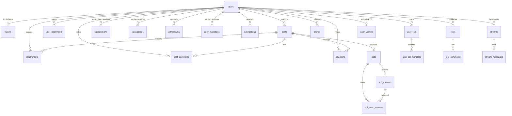

# Database Schema & Entity Reference

The Rust backend initializes and manages 21 relational tables in SQLite (`backend/src/db.rs`).

---

## Entity-Relationship Diagram

---

## Table Definitions

### 1. `users`
Stores member accounts, creator profile metadata, pricing tiers, and privacy flags.
- `id`: `INTEGER PRIMARY KEY AUTOINCREMENT`
- `name`: `TEXT NOT NULL`
- `username`: `TEXT NOT NULL UNIQUE COLLATE NOCASE`
- `email`: `TEXT NOT NULL UNIQUE COLLATE NOCASE`
- `password_hash`: `TEXT NOT NULL` (Bcrypt hash)
- `role_id`: `INTEGER NOT NULL DEFAULT 2` (`1` = Admin, `2` = User/Creator)
- `bio`, `location`, `website`, `avatar`, `cover`, `birthdate`, `gender_id`, `gender_pronoun`
- `profile_access_price` (`DEFAULT 15.0`), `profile_access_price_3_months` (`12.0`), `profile_access_price_6_months` (`10.0`), `profile_access_price_12_months` (`8.0`)
- `public_profile` (`1`), `paid_profile` (`1`), `open_profile` (`0`), `enable_2fa` (`0`), `enable_geoblocking` (`0`)
- `identity_verified_at`, `email_verified_at`, `referral_code`, `created_at`

### 2. `wallets`
- `id`: `INTEGER PRIMARY KEY AUTOINCREMENT`
- `user_id`: `INTEGER NOT NULL UNIQUE REFERENCES users(id) ON DELETE CASCADE`
- `total`: `REAL NOT NULL DEFAULT 0.0`
- `updated_at`: `TEXT NOT NULL DEFAULT (datetime('now'))`

### 3. `posts`
- `id`: `INTEGER PRIMARY KEY AUTOINCREMENT`
- `user_id`: `INTEGER NOT NULL REFERENCES users(id) ON DELETE CASCADE`
- `text`: `TEXT NOT NULL DEFAULT ''`
- `price`: `REAL NOT NULL DEFAULT 0.0` (PPV price; `0.0` = standard post)
- `status`: `INTEGER NOT NULL DEFAULT 1` (`1` = approved/published)
- `is_pinned`: `INTEGER NOT NULL DEFAULT 0`
- `release_date`, `expire_date`, `created_at`

### 4. `attachments`
- `id`: `TEXT PRIMARY KEY` (UUID v4)
- `user_id`: `INTEGER NOT NULL REFERENCES users(id) ON DELETE CASCADE`
- `post_id`: `INTEGER REFERENCES posts(id) ON DELETE SET NULL`
- `message_id`: `INTEGER`
- `filename`, `file_url`, `file_type` (`image`, `video`, `audio`), `file_size`
- `is_vault`: `INTEGER NOT NULL DEFAULT 1`
- `is_archived`: `INTEGER NOT NULL DEFAULT 0`
- `created_at`: `TEXT NOT NULL DEFAULT (datetime('now'))`

### 5. `post_comments`
- `id`: `INTEGER PRIMARY KEY AUTOINCREMENT`
- `post_id`: `INTEGER NOT NULL REFERENCES posts(id) ON DELETE CASCADE`
- `user_id`: `INTEGER NOT NULL REFERENCES users(id) ON DELETE CASCADE`
- `message`: `TEXT NOT NULL`
- `created_at`: `TEXT NOT NULL DEFAULT (datetime('now'))`

### 6. `reactions`
Polymorphic likes table supporting posts, post comments, and reels.
- `id`: `INTEGER PRIMARY KEY AUTOINCREMENT`
- `user_id`: `INTEGER NOT NULL REFERENCES users(id) ON DELETE CASCADE`
- `reaction_type`: `TEXT NOT NULL DEFAULT 'like'`
- `post_id`: `INTEGER REFERENCES posts(id) ON DELETE CASCADE`
- `post_comment_id`: `INTEGER REFERENCES post_comments(id) ON DELETE CASCADE`
- `reel_id`: `INTEGER`

### 7. `polls`, `poll_answers`, `poll_user_answers`
- `polls`: `(id, user_id, post_id UNIQUE, created_at)`
- `poll_answers`: `(id, poll_id REFERENCES polls(id) ON DELETE CASCADE, answer)`
- `poll_user_answers`: `(id, poll_id, user_id, answer_id, UNIQUE(poll_id, user_id))` — Enforces one vote per user per poll (with `ON CONFLICT DO UPDATE` allowing vote changes).

### 8. `user_bookmarks`
- `id`: `INTEGER PRIMARY KEY AUTOINCREMENT`
- `user_id`: `INTEGER NOT NULL REFERENCES users(id) ON DELETE CASCADE`
- `post_id`: `INTEGER REFERENCES posts(id) ON DELETE CASCADE`
- `reel_id`: `INTEGER REFERENCES reels(id) ON DELETE CASCADE`
- Constraints: `UNIQUE(user_id, post_id)`, `UNIQUE(user_id, reel_id)`

### 9. `user_lists` & `user_list_members`
- `user_lists`: `(id, user_id, name, list_type, created_at)` where `list_type` is `'followers'`, `'following'`, `'blocked'`, or `'custom'`.
- `user_list_members`: `(id, list_id, user_id, created_at, UNIQUE(list_id, user_id))`

### 10. `subscriptions`
- `id`: `INTEGER PRIMARY KEY AUTOINCREMENT`
- `sender_user_id`: `INTEGER NOT NULL REFERENCES users(id) ON DELETE CASCADE`
- `recipient_user_id`: `INTEGER NOT NULL REFERENCES users(id) ON DELETE CASCADE`
- `amount`: `REAL NOT NULL DEFAULT 15.0`
- `provider`: `TEXT NOT NULL DEFAULT 'credit'`
- `status`: `TEXT NOT NULL DEFAULT 'completed'` (`completed`, `canceled`, `expired`)
- `expires_at`, `created_at`

### 11. `transactions`
Immutable ledger of all deposits, subscriptions, tips, and PPV unlocks.
- `id`: `INTEGER PRIMARY KEY AUTOINCREMENT`
- `sender_user_id`: `INTEGER NOT NULL REFERENCES users(id) ON DELETE CASCADE`
- `recipient_user_id`: `INTEGER REFERENCES users(id) ON DELETE SET NULL`
- `tx_type`: `TEXT NOT NULL` (`deposit`, `subscription`, `one-month-subscription`, `tip`, `post-unlock`, `message-unlock`, `stream-unlock`)
- `status`: `TEXT NOT NULL DEFAULT 'approved'`
- `amount`: `REAL NOT NULL`
- `currency`: `TEXT NOT NULL DEFAULT 'USD'`
- `payment_provider`: `TEXT NOT NULL DEFAULT 'credit'`
- `post_id`, `message_id`, `stream_id`, `invoice_id`, `created_at`

### 12. `withdrawals`
- `id`: `INTEGER PRIMARY KEY AUTOINCREMENT`
- `user_id`: `INTEGER NOT NULL REFERENCES users(id) ON DELETE CASCADE`
- `amount`: `REAL NOT NULL`
- `status`: `TEXT NOT NULL DEFAULT 'requested'` (`requested`, `approved`, `rejected`)
- `payment_method`, `payment_identifier`, `message`, `created_at`

### 13. `user_messages` & `notifications`
- `user_messages`: `(id, sender_id, receiver_id, message, price, is_seen, is_pinned, created_at)`
- `notifications`: `(id TEXT PRIMARY KEY, from_user_id, to_user_id, notification_type, post_id, message, is_read, created_at)`

### 14. `reels`, `reel_comments`, `stories`, `streams`, `stream_messages`
- `reels`: `(id, user_id, caption, video_url, cover_url, price, views_count, created_at)`
- `reel_comments`: `(id, reel_id, user_id, message, created_at)`
- `stories`: `(id, user_id, media_url, media_type, caption, bg_preset, is_highlight, views_count, expires_at, created_at)`
- `streams`: `(id, user_id, name, slug, poster, price, requires_subscription, is_public, status, rtmp_server, rtmp_key, hls_link, viewer_count, created_at)`
- `stream_messages`: `(id, stream_id, user_id, message, created_at)`

### 15. `settings`, `public_pages`, `contact_messages`, `user_reports`, `user_verifies`
- `settings`: Key-value store for site configuration.
- `public_pages`: CMS pages (`terms-and-conditions`, `privacy`, `help`).
- `contact_messages`: Public contact form submissions.
- `user_reports`: Content/user moderation reports (`status`: `received`, `resolved`, `dismissed`).
- `user_verifies`: Creator KYC identity verification requests (`status`: `pending`, `approved`, `rejected`, `files`: JSON string array).
