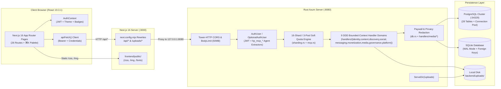

# System Architecture & Data Flow

## 1. High-Level Topology



---

## 1.1 Domain-Driven Design (DDD) Bounded-Context Handler Layout

As documented in **[ADR-008](../adr/008-ddd-bounded-context-handlers-refactoring.md)**, the backend route handlers are organized into **9 bounded-context directories** under [`backend/src/handlers/`](../../backend/src/handlers/) (with [`backend/src/handlers.rs`](../../backend/src/handlers.rs) acting as the top-level re-export facade and [`backend/src/main.rs`](../../backend/src/main.rs) binding routes via `handlers::<domain>::*`):

| Bounded Context (`handlers/<domain>/`) | Sub-Domain Modules | Core Responsibilities |
| :--- | :--- | :--- |
| **`content/`** | `posts.rs`, `engagement.rs` | Post CRUD, pin toggles, reactions, bookmarks, comments, and poll voting (`vote_poll`). |
| **`discovery/`** | `feed.rs`, `profiles.rs`, `search.rs` | Paginated category-filtered feed (`get_feed`), creator suggestions, public profiles (`get_profile`), and Explore search (`search_handler`). |
| **`governance/`** | `tokens.rs`, `personas.rs` | Scoped `hp_mcp_*` agent token minting/revocation, 16-shard telemetry, and No-Inference Autonomous Persona Studio (`agent_personas`). |
| **`identity/`** | `auth.rs`, `settings.rs` | User registration/login/logout/me, profile/rates/account/privacy settings, and KYC verification submission. |
| **`media/`** | `vault.rs`, `reels.rs`, `stories.rs`, `streams.rs` | Media Vault uploads/archiving, short-form PPV Reels, 24h Stories & Highlights, and RTMP/HLS Live Streams. |
| **`messaging/`** | `dm.rs`, `broadcast.rs` | 1-on-1 Direct Messenger, PPV message unlocks, message pinning, and mass subscriber/follower Broadcast DMs. |
| **`monetization/`** | `ledger.rs`, `analytics.rs` | Unified `BEGIN IMMEDIATE` ACID payment ledger (`initiate_payment`), 85/15 creator split, withdrawals, invoices, and creator analytics. |
| **`platform/`** | `home.rs`, `admin.rs` | Health check, home discovery, public CMS pages, contact form, AI caption assistant, abuse reports, and Admin Dashboard. |
| **`social/`** | `lists.rs`, `graph.rs`, `notifications.rs` | Saved bookmarks (`get_bookmarks`), custom user lists, follow/block graph (`toggle_follow`, `toggle_block_user`), and activity notifications. |

---

## 2. Authentication & Session Flow

The platform supports dual-channel stateless JWT authentication plus scoped `hp_mcp_*` autonomous agent tokens so browser navigation, SPA fetch calls, and MCP agents work seamlessly:

```mermaid
sequenceDiagram
    participant C as Next.js Client
    participant N as Next.js Rewrite Proxy (:3000)
    participant A as Axum Identity Handler (:8080)
    participant DB as SQLite / PostgreSQL

    C->>N: POST /api/auth/login { email, password }
    N->>A: Forward POST /api/auth/login (handlers::identity::login)
    A->>DB: SELECT id, username, password_hash, role_id FROM users
    A->>A: bcrypt::verify(password, password_hash)
    A->>A: create_jwt(user_id, username, role_id) [30-day exp]
    A-->>N: 200 OK + Set-Cookie: justfans_token=<jwt>; HttpOnly; SameSite=Lax\nBody: { token, user }
    N-->>C: Forward response & cookie
    C->>C: Store token in localStorage ('justfans_jwt_token')\nUpdate AuthContext state
```

### Request Extraction (`backend/src/auth.rs`)
On every incoming request:
1. `extract_token_from_parts` checks the `X-Agent-Token: hp_mcp_*` or `Authorization: Bearer <token>` header first.
2. If absent, it falls back to parsing the `Cookie` header for `justfans_token=<token>`.
3. Endpoints requiring login use the `AuthUser` extractor (rejects missing/invalid tokens with `401 Unauthorized` and enforces agent capability scopes via `auth.require_scope(...)`).
4. Public endpoints that personalize output when logged in (such as `/api/feed`, `/api/profile/:username`, `/api/posts/:post_id`, `/api/streams`, `/api/reels`) use `OptionalAuthUser(Option<AuthUser>)`.

---

## 3. Paywall & Content Unlock Lifecycle

```mermaid
flowchart TD
    Req["Viewer requests Post / Reel / Stream / Message"] --> CheckOwner{"Is Viewer the Author\nor Admin (role_id == 1)?"}
    CheckOwner -->|Yes| Unlocked["is_unlocked = true\nFull text, poll, media & HLS returned"]
    CheckOwner -->|No| CheckSub{"Does Author require\nsubscription?"}
    CheckSub -->|Yes| HasSub{"Active row in subscriptions\n(status='completed' & expires_at >= now)?"}
    CheckSub -->|No (Open/Free Profile)| CheckPPV
    HasSub -->|No| Locked["is_unlocked = false\nMask text, null poll, /img/post-locked.svg"]
    HasSub -->|Yes| CheckPPV{"Does item have\nprice > 0.0?"}
    CheckPPV -->|No (price == 0)| Unlocked
    CheckPPV -->|Yes| HasTx{"Approved unlock row in\ntransactions for viewer?"}
    HasTx -->|Yes| Unlocked
    HasTx -->|No| Locked
```

---

## 4. Concurrency & Database Access Model

- `AppState` holds `Arc<Mutex<rusqlite::Connection>>` alongside a pooled PostgreSQL connection vector (`postgres_pool: Arc<Mutex<Vec<postgres::Client>>>`), `uploads_dir`, and `public_dir`.
- SQLite is initialized with:
  - `PRAGMA foreign_keys = ON;` — Ensures cascading deletes across posts, comments, reactions, polls, bookmarks, list members, and subscriptions.
  - `PRAGMA journal_mode = WAL;` — Enables Write-Ahead Logging for durability and fast disk commits.
- Handler functions across `backend/src/handlers/<domain>/*` acquire the mutex lock for the duration of their synchronous queries and execute multi-step financial mutations inside `rusqlite::TransactionBehavior::Immediate` (`BEGIN IMMEDIATE`) transactions. In `handlers::media::upload_attachment` ([`backend/src/handlers/media/vault.rs`](../../backend/src/handlers/media/vault.rs)), file bytes are streamed from the multipart body and written to disk *before* acquiring the database mutex lock to minimize lock contention.

