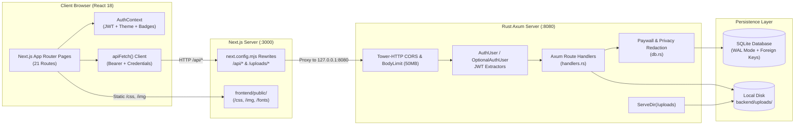

# System Architecture & Data Flow

## 1. High-Level Topology



---

## 2. Authentication & Session Flow

The platform supports dual-channel stateless JWT authentication so both browser navigation and programmatic API clients work seamlessly:

```mermaid
sequenceDiagram
    participant C as Next.js Client
    participant N as Next.js Rewrite Proxy (:3000)
    participant A as Axum Auth Handler (:8080)
    participant DB as SQLite

    C->>N: POST /api/auth/login { email, password }
    N->>A: Forward POST /api/auth/login
    A->>DB: SELECT id, username, password_hash, role_id FROM users
    A->>A: bcrypt::verify(password, password_hash)
    A->>A: create_jwt(user_id, username, role_id) [30-day exp]
    A-->>N: 200 OK + Set-Cookie: justfans_token=<jwt>; HttpOnly; SameSite=Lax\nBody: { token, user }
    N-->>C: Forward response & cookie
    C->>C: Store token in localStorage ('justfans_jwt_token')\nUpdate AuthContext state
```

### Request Extraction (`backend/src/auth.rs`)
On every incoming request:
1. `extract_token_from_parts` checks the `Authorization: Bearer <token>` header first.
2. If absent, it falls back to parsing the `Cookie` header for `justfans_token=<token>`.
3. Endpoints requiring login use the `AuthUser` extractor (rejects missing/invalid tokens with `401 Unauthorized`).
4. Public endpoints that personalize output when logged in (such as `/api/feed`, `/api/profile/:username`, `/api/posts/:post_id`, `/api/streams`, `/api/reels`) use `OptionalAuthUser(Option<AuthUser>)`.

---

## 3. Paywall & Content Unlock Lifecycle

```mermaid
flowchart TD
    Req["Viewer requests Post / Stream / Message"] --> CheckOwner{"Is Viewer the Author\nor Admin (role_id == 1)?"}
    CheckOwner -->|Yes| Unlocked["is_unlocked = true\nFull text, poll, media & HLS returned"]
    CheckOwner -->|No| CheckSub{"Does Author require\nsubscription?"}
    CheckSub -->|Yes| HasSub{"Active row in subscriptions\n(status='completed' & expires_at >= now)?"}
    CheckSub -->|No (Open/Free Profile)| CheckPPV
    HasSub -->|No| Locked["is_unlocked = false\nMask text, null poll, /img/post-locked.svg"]
    HasSub -->|Yes| CheckPPV{"Does item have\nprice > 0.0?"}
    CheckPPV -->|No (price == 0)| Unlocked
    CheckPPV -->|Yes| HasTx{"Approved unlock row in\ntransactions for viewer?"}
    HasTx -->|Yes| Unlocked
    HasTx -->|No| Locked
```

---

## 4. Concurrency & Database Access Model

- `AppState` holds `Arc<Mutex<rusqlite::Connection>>` alongside `uploads_dir` and `public_dir`.
- SQLite is initialized with:
  - `PRAGMA foreign_keys = ON;` — Ensures cascading deletes across posts, comments, reactions, polls, bookmarks, list members, and subscriptions.
  - `PRAGMA journal_mode = WAL;` — Enables Write-Ahead Logging for durability and fast disk commits.
- Handler functions acquire the mutex lock for the duration of their synchronous SQLite queries and release it before returning the Axum JSON response. In `upload_attachment`, file bytes are streamed from the multipart body and written to disk *before* acquiring the SQLite mutex lock to minimize lock contention.
