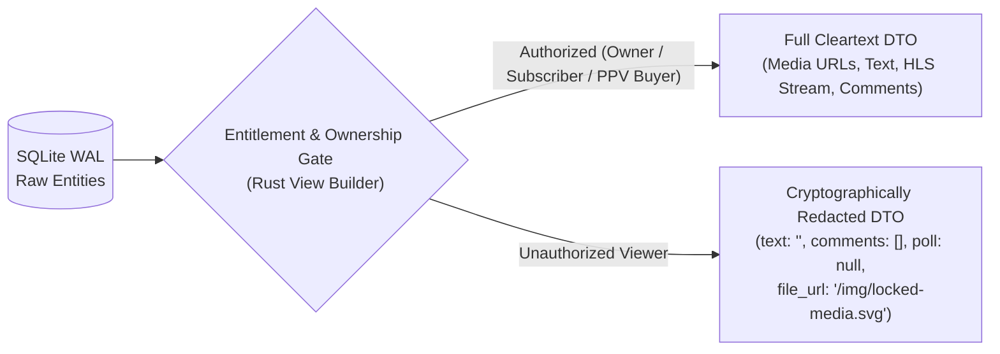

# Philosophy Paper: Creator Sovereignty, Cryptographic Entitlement & Zero-Bloat Systems Design

- **Document ID**: `PAPER-001`
- **Title**: *The Philosophy of HEAV3NS-Publishing: Why Creator Economy Infrastructure Must Be Verifiable, Local-First, and Ergonomic*
- **Authors**: HEAV3NS-Publishing Core Architecture Group
- **Version**: `2.0.0` (November 2026)

---

## Abstract

Digital creator platforms sit at the intersection of artistic publishing, private community building, and high-trust financial custody. Yet most modern creator platforms suffer from three structural pathologies: (1) **opaque algorithmic intermediaries** that throttle creator reach and extract punitive platform fees, (2) **porous client-side paywalls** that leak creator intellectual property and subscriber personally identifiable information (PII) in raw network responses, and (3) **bloated multi-service infrastructure** that makes self-hosting, auditing, and deterministic verification prohibitively expensive.

**HEAV3NS-Publishing** was designed from first principles to reject these compromises. This paper articulates the four philosophical pillars that govern every architectural, financial, and user-experience decision in the repository.

---

## 1. Pillar I: Creator Sovereignty & Transparent Economics

A publishing platform exists to serve the creator-audience relationship, not to interpose itself between them.

### 1.1 Deterministic 85 / 15 Revenue Split
In **HEAV3NS-Publishing**, creator compensation is not subject to opaque ad-revenue pools or delayed monthly recalculations. Every monetization primitive—whether a 1/3/6/12-month subscription bundle, a promotional offer, a Pay-Per-View (PPV) post, a PPV short-form reel, a locked direct message, a VIP live stream ticket, or an in-chat tip—is governed by a single immutable formula at the moment of settlement:

$$\text{Creator Credit} = \operatorname{round}\left(\text{Gross Amount} \times 0.85,\; 2\right)$$

$$\text{Platform Fee} = \text{Gross Amount} - \text{Creator Credit}$$

The creator's wallet (`wallets.total`) is credited atomically inside the same database transaction that debits the fan, providing instant liquidity and a mathematically auditable ledger (`transactions`).

### 1.2 Direct Audience Ownership
Creators control how their work is packaged:
- **Open Profiles with Selective PPV**: Creators can keep their feed free to build top-of-funnel discovery while monetizing individual flagship posts, reels, or live streams via PPV unlocks.
- **Tiered Subscription Bundles & Promotional Campaigns**: Creators can run time-boxed promotional discounts (`creator_offers`) and multi-month bundles (`3m`, `6m`, `12m`) without platform gatekeeping.
- **Direct & Broadcast Communication**: Creators can message individual supporters or send targeted broadcasts to curated fan lists (`user_lists`) without algorithmic suppression.

---

## 2. Pillar II: Security as a Serialization-Boundary Invariant

A recurring failure mode in web applications is treating access control as a *presentation* concern—sending a complete database object over JSON and relying on the frontend to render a blurred overlay or hide sensitive fields.

**HEAV3NS-Publishing** enforces a strict philosophical rule: **The network boundary is an adversarial boundary.**

1. **Zero-Leak Paywalls**: If a viewer has not unlocked a post, reel, message, or live stream, the Rust backend strips the cleartext body, poll options, comment threads, media file URLs, and HLS `.m3u8` stream links *before* the struct is serialized to JSON ([ADR-004](../adr/004-server-side-paywall-and-privacy-masking.md)). Inspecting browser DevTools reveals zero hidden content.
2. **Zero-Leak Public Profiles**: Public profile lookups (`GET /api/profile/:username`) redact `email`, `birthdate`, `wallet_balance`, and all billing address metadata unless the requester is cryptographically authenticated as the account owner or an administrator.
3. **Authoritative Server Pricing**: The client UI may display prices for convenience, but the backend payment engine (`POST /api/payments/initiate`) ignores client-submitted prices for subscriptions and PPV unlocks, querying the authoritative price directly from SQLite inside an immediate transaction ([ADR-005](../adr/005-unified-payment-ledger-and-creator-split.md)).

---

## 3. Pillar III: Zero-Bloat, Local-First Mechanical Sympathy

Modern software engineering often conflates *distributed complexity* with *robustness*. Requiring five containers (API server, external RDBMS, Redis cache, object-storage emulator, and reverse proxy) just to boot a development environment slows down human engineers and cripples automated AI coding agents.

**HEAV3NS-Publishing** embraces **Radical Simplicity and Mechanical Sympathy**:

- **Single-Binary Rust Backend (`backend/`)**: Compiled with **Axum 0.7**, **Tokio**, and **bundled SQLite (`rusqlite`)** in Write-Ahead Logging (`WAL`) mode (plus pooled PostgreSQL support). Cloning the repository and running `cargo run` initializes all 28 relational tables, enforces foreign-key constraints, and seeds realistic creator/fan demo data in milliseconds.
- **Domain-Driven Design (DDD) Bounded-Context Modularity ([ADR-008](../adr/008-ddd-bounded-context-handlers-refactoring.md))**: All 75+ route handlers are organized into 9 clean bounded-context directories under [`backend/src/handlers/`](../../backend/src/handlers/) (`identity`, `content`, `discovery`, `social`, `messaging`, `monetization`, `media`, `governance`, `platform`) with explicit `handlers::<domain>::*` route bindings in [`backend/src/main.rs`](../../backend/src/main.rs).
- **Deterministic In-Memory Verification**: Because the local persistence layer is embedded SQLite, the integration test suite (`cargo test`) spins up isolated `:memory:` databases and verifies 75+ HTTP endpoints, financial edge cases, sharding/soft quotas, MCP tools, and paywall invariants in **under 1 second**.
- **Explicit Over Implicit**: Rather than hiding SQL queries behind complex macro-heavy ORMs or runtime reflection, [`backend/src/db.rs`](../../backend/src/db.rs) and [`backend/src/handlers/`](../../backend/src/handlers/) (re-exported via [`backend/src/handlers.rs`](../../backend/src/handlers.rs)) use explicit, auditable SQL paired with strongly typed Rust `serde` structs and `TransactionBehavior::Immediate` guards.

---

## 4. Pillar IV: Keyboard-First, High-Craft Ergonomics

Creator tools should feel as fast and responsive as a professional creative workstation (like Linear, Figma, or Raycast), while consumer discovery should feel as fluid as modern social video apps.

- **Universal Command Palette (`⌘K` / `Ctrl+K`)**: Every major destination, creator publishing workflow (New Post, New Reel, New Story, Go Live), theme toggle, and Explore search query is reachable in two keystrokes via [`AppShell.tsx`](../../frontend/src/components/AppShell.tsx).
- **Unified Media Vault**: Creators upload once to their personal Media Vault (`/my/vault`) and seamlessly attach existing photos, videos, or audio across feed posts, short-form Reels, and direct messages without redundant uploads.
- **Agent-Native Workspace Design**: Documentation, ADRs, operational playbooks, and post-mortems live alongside the code in structured Markdown (`docs/`), enabling both human engineers and autonomous AI agents to reason about system invariants without tribal knowledge.

---

## 5. Summary of Guiding Maxims

| Maxim | Architectural Manifestation |
| :--- | :--- |
| **"Never trust the client with money or entitlements."** | Server-authoritative pricing & `BEGIN IMMEDIATE` SQLite ledger transactions in [`handlers/monetization/ledger.rs`](../../backend/src/handlers/monetization/ledger.rs). |
| **"If it is locked, it does not cross the wire."** | Server-side redaction of text, polls, comments, media URLs, and HLS links in [`db.rs`](../../backend/src/db.rs) & [`handlers/media/`](../../backend/src/handlers/media/). |
| **"Zero-config startup, sub-second verification."** | Embedded SQLite WAL + in-memory integration test suites (`10+` suites in `<0.5s`). |
| **"Documentation is executable institutional memory."** | Every bug class discovered during engineering audits is immortalized as a Post-Mortem (`docs/post-mortems/`) and a permanent regression test. |

