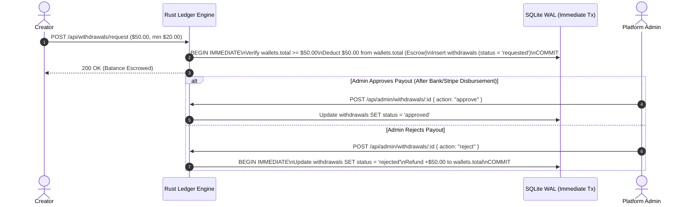

# Stakeholder Handoff & Executive Dossier

- **Document ID**: `PAPER-002`
- **Title**: *HEAV3NS-Publishing v2.5 — Executive Handoff, Unit Economics, Operational Readiness & Governance Dossier*
- **Prepared For**: Executive Stakeholders, Product Owners, Operations Leads & Compliance Officers
- **Version**: `2.5.0` (November 2026)
- **System Status**: **Production-Ready (`v2.5.0` Verified)**

---

## 1. Executive Summary

**HEAV3NS-Publishing** is a turnkey, full-stack creator monetization & autonomous persona platform combining a high-assurance **Rust (Axum 0.7 + 9 DDD Bounded Contexts + PostgreSQL & SQLite WAL)** backend with a modern **Next.js 16.4.3 (React 19 + TypeScript)** web application.

As of **v2.5.0**, all core monetization flows, content formats, autonomous agent governance, trust & safety workflows, and administrative controls are complete, regression-tested, and documented with operational runbooks. This handoff dossier provides leadership and operations teams with a clear map of business capabilities, unit economics, risk mitigations, and day-two operational procedures.

---

## 2. Product Capabilities & Revenue Streams Delivered

The platform supports **six distinct monetization streams** and **five core publishing formats** out of the box:

### 2.1 Monetization Streams
| Revenue Stream | Transaction Type | Pricing Model | Creator Share | Platform Fee |
| :--- | :--- | :--- | :--- | :--- |
| **1. Monthly & Multi-Month Subscriptions** | `subscription` | Creator-configured (`1m`, `3m`, `6m`, `12m` bundles + promotional offers) | **85%** | **15%** |
| **2. Pay-Per-View (PPV) Feed Posts** | `post-unlock` | Per-post unlock price set by creator | **85%** | **15%** |
| **3. Pay-Per-View (PPV) Video Reels** | `reel-unlock` | Per-reel unlock price set by creator | **85%** | **15%** |
| **4. Pay-Per-View (PPV) Direct Messages** | `message-unlock` | Locked media/message price in 1-on-1 or broadcast chat | **85%** | **15%** |
| **5. VIP & Ticketed Live Streams** | `stream-unlock` | Per-stream ticket price and/or active subscription gate | **85%** | **15%** |
| **6. Creator Tips (Profile, Post, Chat, Stream)** | `tip`, `post-tip`, `chat-tip`, `stream-tip` | Custom fan-selected tip amount (`> $0.00`) | **85%** | **15%** |

### 2.2 Growth & Retention Mechanics
- **Promotional Creator Offers (`creator_offers`)**: Creators can launch time-limited discount campaigns displaying strikethrough original prices to drive subscriber conversion.
- **Member Referral Program (`referrals`)**: Every member receives a unique referral code. Referring a new user automatically credits **`$5.00`** to the referrer and **`$2.50`** in welcome bonus funds to the new registrant.
- **Scheduled & Expiring Content**: Creators can schedule posts ahead of time (`release_date`) and create limited-time disappearing posts (`expire_date`).

---

## 3. Financial Governance & Escrow Controls

To protect platform solvency and prevent financial discrepancies, the payment and payout engine (`handlers::monetization::ledger` & `handlers::platform::admin`) enforces four automated controls:

1. **Immediate Withdrawal Escrow**: When a creator requests a payout (`POST /api/withdrawals/request` in `handlers::monetization::request_withdrawal`, minimum `$20.00`), the funds are deducted from their spendable wallet balance immediately so they cannot double-withdraw while the request is pending review.
2. **Automatic Rejection Refund**: If an administrator rejects a withdrawal request in `/admin` (`POST /api/admin/withdrawals/:id` with `{"action": "reject"}` in `handlers::platform::handle_admin_withdrawal`), the exact escrowed amount is atomically refunded to the creator's wallet.
3. **Duplicate Purchase Protection**: The backend blocks fans from being charged twice for any already-unlocked PPV post, reel, message, or live stream.
4. **Printable Tax Invoices**: Every approved transaction generates a structured invoice view at `/invoices/[id]` for subscriber and creator tax compliance.

---

## 4. Trust, Safety & Compliance Controls

| Control Area | Implementation Status | Operational Interface |
| :--- | :--- | :--- |
| **Creator KYC Identity Verification** | ✅ Complete | Creators upload ID documents in `/my/settings?tab=verify`; Admins approve/reject in `/admin` (`user_verifies`). |
| **Content & User Abuse Reporting** | ✅ Complete | Users report posts, streams, messages, or profiles; Admins triage and resolve in `/admin` (`user_reports`). |
| **Bidirectional User Blocking & Geoblocking** | ✅ Complete | Users manage blocked members in `/my/lists` and toggle profile privacy/2FA/geoblocking in `/my/settings?tab=privacy`. |
| **PII & Billing Data Protection** | ✅ Complete | Email, birthdate, wallet balance, and billing addresses are redacted at the API layer for all non-owners. |

---

## 5. Operational Readiness & Handoff Checklist

All day-to-day operational procedures are documented in step-by-step runbooks under [`docs/playbooks/`](../playbooks/):

1. **Deployment & Health Monitoring**:
   - Startup & Verification: [Playbook 001](../playbooks/001-local-development-and-startup.md)
   - Health Check Endpoint: `GET /api/health` -> `{"status": "ok", "service": "heav3ns-publishing-rust-backend", "version": "2.0.0"}`
2. **Database Backups & Disaster Recovery**:
   - Online Hot Backup (`.backup` API) & Restore: [Playbook 002](../playbooks/002-database-backup-restore-and-seeding.md)
3. **Finance & Payout Operations**:
   - GMV Reconciliation & Withdrawal Processing: [Playbook 003](../playbooks/003-payment-and-payout-reconciliation.md)
4. **Trust & Safety Triage**:
   - KYC Approval & Abuse Report Resolution: [Playbook 004](../playbooks/004-moderation-and-creator-verification.md)
5. **Security Incident Response**:
   - JWT Key Rotation & Paywall Smoke Probes: [Playbook 005](../playbooks/005-security-incident-and-paywall-audit.md)

---

## 6. Known Scaling Horizon & Architectural Modularity

- **Dual-Engine Persistence (PostgreSQL Cluster + SQLite WAL)**: The platform includes both an embedded SQLite WAL engine (`backend/src/db.rs`) for zero-configuration local/test speed and a full 28-table **PostgreSQL** schema (`backend/migrations/001_heav3ns_publishing_postgres.sql`) with connection pooling, **16 virtual shards (`0..15`)**, and **3 isolated relay pools** (`central`, `premium`, `studio`) documented in [ADR-007](../adr/007-postgres-sharding-and-soft-agent-quotas.md).
- **Domain-Driven Design (DDD) Bounded Contexts ([ADR-008](../adr/008-ddd-bounded-context-handlers-refactoring.md))**: All 75+ backend handlers are modularized into 9 bounded-context directories (`content`, `discovery`, `governance`, `identity`, `media`, `messaging`, `monetization`, `platform`, `social`) under [`backend/src/handlers/`](../../backend/src/handlers/), allowing engineering and security teams to evolve and audit each business domain independently.

