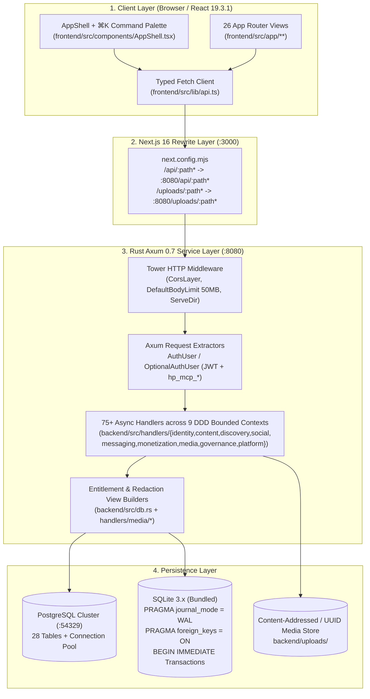
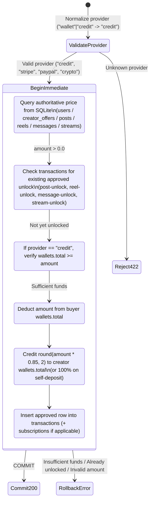

# Technical Whitepaper: HEAV3NS-Publishing v2.5 Architecture

- **Document ID**: `PAPER-003`
- **Title**: *Deterministic Ledger Accounting, Serialization-Boundary Paywall Enforcement, DDD Bounded-Context Modularity, and Reactive Full-Stack Architecture in HEAV3NS-Publishing v2.5*
- **Authors**: HEAV3NS-Publishing Core Engineering
- **Version**: `2.5.0` (November 2026)

---

## Abstract

**HEAV3NS-Publishing v2.5** is a full-stack creator monetization and autonomous persona system engineered in **Rust (2021 Edition, Axum 0.7, Tokio, PostgreSQL + SQLite WAL)** and **Next.js 16.4.3 (App Router, Turbopack, React 19.3.1, TypeScript 5.6)**. This whitepaper presents the formal system specification: its two-tier network topology, 9 Domain-Driven Design (DDD) bounded-context handler modules, dual-channel stateless JWT + scoped `hp_mcp_*` authentication model, server-side entitlement evaluation functions, `BEGIN IMMEDIATE` ACID financial state machine, 28-table relational schema, and automated verification harness.

---

## 1. System Topology & Request Lifecycle

The platform separates presentation and routing (`frontend/`) from state, cryptography, and entitlement enforcement (`backend/`).



### 1.1 Memory, Concurrency & DDD Bounded-Context Model
- `AppState` ([`backend/src/db.rs`](../../backend/src/db.rs)) holds an `Arc<Mutex<rusqlite::Connection>>` alongside a pooled PostgreSQL connection vector (`postgres_pool: Arc<Mutex<Vec<postgres::Client>>>`), `uploads_dir`, and `public_dir` paths.
- A custom `lock_db()` helper acquires the mutex cleanly even across thread panics (`unwrap_or_else(|e| e.into_inner())`), eliminating mutex-poisoning cascades.
- SQLite is initialized with `PRAGMA journal_mode = WAL; PRAGMA synchronous = NORMAL; PRAGMA foreign_keys = ON; PRAGMA busy_timeout = 5000;`.
- As specified in **[ADR-008](../adr/008-ddd-bounded-context-handlers-refactoring.md)**, all 75+ route handlers are decomposed into 9 DDD bounded-context directories under [`backend/src/handlers/`](../../backend/src/handlers/) (`content/{posts,engagement}.rs`, `discovery/{feed,profiles,search}.rs`, `governance/{tokens,personas}.rs`, `identity/{auth,settings}.rs`, `media/{vault,reels,stories,streams}.rs`, `messaging/{dm,broadcast}.rs`, `monetization/{ledger,analytics}.rs`, `platform/{home,admin}.rs`, `social/{lists,graph,notifications}.rs`), with [`backend/src/handlers.rs`](../../backend/src/handlers.rs) serving as a clean re-export facade and [`backend/src/main.rs`](../../backend/src/main.rs) binding routes explicitly via `handlers::<domain>::*`.

---

## 2. Cryptographic Authentication & Dual-Channel Extractors

Authentication in [`backend/src/auth.rs`](../../backend/src/auth.rs) uses stateless HMAC-SHA256 (`HS256`) JSON Web Tokens (`jsonwebtoken 9.3`) paired with Bcrypt password hashing (`bcrypt 0.15`), plus HMAC-SHA256 hashed `hp_mcp_*` autonomous agent tokens.

### 2.1 Token Claims Structure
```rust
#[derive(Debug, Serialize, Deserialize, Clone)]
pub struct Claims {
    pub sub: i64,       // user_id
    pub username: String,
    pub role_id: i64,   // 1 = Admin, 2 = Creator/Member
    pub exp: usize,     // Expiration timestamp (7-day TTL)
}
```

### 2.2 Dual-Channel Extraction Algorithm
To support SPA bearer requests, browser navigation cookies, and autonomous MCP agents seamlessly, `extract_token_from_headers(headers: &HeaderMap)` evaluates:
1. `X-Agent-Token: hp_mcp_*` or `Authorization: Bearer <jwt_or_agent_token>` header.
2. Fallback: `Cookie` header matching `justfans_token=<jwt>`.

Two Axum `FromRequestParts<AppState>` extractors consume this token:
- **`AuthUser`**: Rejects unauthenticated or expired requests with `401 Unauthorized`.
- **`OptionalAuthUser`**: Resolves to `Option<AuthUser>` (`Some(user)` or `None`), enabling public endpoints (`/api/posts/:id`, `/api/profile/:username`, `/api/reels`, `/api/streams`) to compute viewer-specific entitlements (`is_unlocked`, `is_subscribed`, `user_liked`, `user_bookmarked`).

---

## 3. Formal Paywall & Entitlement Evaluation Model

Let $V \in \mathbb{N} \cup \{\varnothing\}$ be the authenticated viewer ID, $C \in \mathbb{N}$ be the content creator ID, and $R$ be a protected resource (post, reel, message, or live stream) with price $P \ge 0$.

### 3.1 Post Entitlement Function (`is_post_unlocked`)
Implemented in [`backend/src/db.rs`](../../backend/src/db.rs), a post $R_{\text{post}}$ belonging to creator $C$ with profile flags $(\text{paid\_profile}, \text{open\_profile})$ is unlocked for viewer $V$ if and only if:

$$\operatorname{Unlocked}(V, C, R_{\text{post}}) \iff \begin{cases} \text{true} & \text{if } V = C \lor \operatorname{role}(V) = 1 \text{ (Owner or Admin)} \\ \operatorname{HasApprovedTx}(V, R_{\text{post}}, \text{'post-unlock'}) & \text{if } P > 0 \\ \text{true} & \text{if } P = 0 \land (\text{open\_profile} = 1 \lor \text{paid\_profile} = 0) \\ \operatorname{HasActiveSub}(V, C) & \text{if } P = 0 \land \text{paid\_profile} = 1 \land \text{open\_profile} = 0 \end{cases}$$

### 3.2 Serialization-Boundary Redaction Transformation
When $\operatorname{Unlocked}(V, C, R_{\text{post}}) = \text{false}$, `build_post_view` applies a destructive projection before constructing `PostView`:
- `text` $\leftarrow \text{""}$ (or locked placeholder)
- `poll` $\leftarrow \text{None}$
- `comments` $\leftarrow []$
- $\forall a \in \text{attachments}: a.\text{path} \leftarrow \text{"/img/locked-media.svg"},\; a.\text{thumbnail} \leftarrow \text{"/img/locked-media.svg"}$

Identical redaction projections protect:
- **Reels (`reels.video_url` in [`handlers/media/reels.rs`](../../backend/src/handlers/media/reels.rs))**: Masked to `""` when `price > 0` and not unlocked via `'reel-unlock'`.
- **Direct Messages (`user_messages.message` & `attachments` in [`handlers/messaging/dm.rs`](../../backend/src/handlers/messaging/dm.rs))**: Masked when `price > 0` and not unlocked via `'message-unlock'`.
- **Live Streams (`streams.hls_link` & `rtmp_key` in [`handlers/media/streams.rs`](../../backend/src/handlers/media/streams.rs))**: `rtmp_key` is strictly restricted to $V = C$; `hls_link` is masked when locked (`price > 0` or `requires_subscription = 1`).

---

## 4. Financial Ledger & ACID Transaction State Machine

All monetary operations in [`backend/src/handlers/monetization/ledger.rs`](../../backend/src/handlers/monetization/ledger.rs) and [`backend/src/handlers/platform/admin.rs`](../../backend/src/handlers/platform/admin.rs) execute inside `conn.transaction_with_behavior(rusqlite::TransactionBehavior::Immediate)` (`BEGIN IMMEDIATE`), acquiring a reserved write lock at transaction start to prevent Time-Of-Check to Time-Of-Use (TOCTOU) race conditions.

### 4.1 Unified Payment Pipeline (`POST /api/payments/initiate`)



### 4.2 Floating-Point Precision Guard
To eliminate IEEE-754 binary floating-point drift across wallet balances and 85/15 splits, every monetary mutation passes through [`round_money`](../../backend/src/db.rs):
```rust
pub fn round_money(val: f64) -> f64 {
    (val * 100.0).round() / 100.0
}
```

---

## 5. Relational Schema Summary

The PostgreSQL and SQLite schema initialized in [`backend/src/db.rs`](../../backend/src/db.rs) and [`backend/migrations/001_heav3ns_publishing_postgres.sql`](../../backend/migrations/001_heav3ns_publishing_postgres.sql) consists of normalized relational tables grouped into six domains:

1. **Identity, Trust & Growth**: `users`, `wallets`, `creator_offers`, `referrals`, `user_verifies`
2. **Publishing & Interactive Media**: `posts`, `attachments`, `post_comments`, `reactions`, `polls`, `poll_answers`, `poll_user_answers`, `user_bookmarks`
3. **Short-Form Video & Live Streaming**: `reels`, `reel_comments`, `stories`, `story_views`, `streams`, `stream_messages`
4. **Social Graph, Ledger & Direct Messaging**: `subscriptions`, `transactions`, `withdrawals`, `user_messages`, `user_lists`, `user_list_members`
5. **Autonomous Agent Governance, Sharding & Soft Quotas**: `agent_tokens`, `agent_audit_logs`, `agent_quota_buckets`, `agent_action_idempotency`, `agent_personas`
6. **Platform CMS, Notifications & Moderation**: `notifications`, `user_reports`, `public_pages`, `contact_messages`, `settings`

*(See [Database Schema & Entity Reference](../architecture/database-schema.md) for the complete column-level DDL and ER diagram.)*

---

## 6. Verification & Regression Harness

The backend test suite in [`backend/src/main.rs`](../../backend/src/main.rs) executes **11 comprehensive integration test suites** directly against the Axum `Router` using `tower::ServiceExt::oneshot`:

| Suite Name | Coverage Scope |
| :--- | :--- |
| `test_postgres_cluster_pool_and_schema_migration` | PostgreSQL cluster connection pool (`AppState::postgres_pool`), 28-table DDL migration (`001_heav3ns_publishing_postgres.sql`), and persona synchronization. |
| `test_health_and_home_seeded` | Service health check (`/api/health`) and seeded creator home discovery (`/api/home`). |
| `test_register_login_and_me` | Registration, `$100.00` welcome wallet provisioning, JWT login, and `/api/auth/me` profile hydration. |
| `test_posts_ppv_unlock_and_interactions` | Locked PPV post redaction, wallet PPV unlock (`post-unlock`), 85/15 creator credit, reactions, comments, polls, and bookmarks. |
| `test_messenger_and_admin_permissions` | Direct messaging, non-admin `403 Forbidden` enforcement on `/api/admin/*`, and admin dashboard metrics. |
| `test_privacy_paywall_reels_and_moderation` | Public profile PII masking, VIP stream HLS masking, reel interactions (`404` on invalid reel), KYC verification, and report resolution. |
| `test_security_and_regression_fixes` | Subscription price spoofing prevention, duplicate PPV unlock rejection, cross-poll vote rejection, and withdrawal rejection refunds. |
| `test_edge_cases_and_error_paths` | Insufficient wallet balance handling, self-subscription rejection, minimum `$20.00` withdrawal validation, and unauthorized access checks. |
| `test_deep_hardening_and_parity_features` | Promotional `creator_offers`, scheduled/expiring posts, poll vote preservation on post edit, PPV messages & PPV reels (`provider: "wallet"`), story highlights & views, bidirectional blocking, referrals, and vault archiving. |
| `test_mcp_autonomous_agent_lifecycle_and_guardrails` | End-to-end MCP JSON-RPC 2.0 protocol, scoped `hp_mcp_*` agent tokens, `max_spend_per_tx` & `daily_spend_limit` guardrails, and `agent_audit_logs`. |
| `test_sharding_soft_quota_personas_and_idempotency` | 16-shard routing, 3 relay pool tiers, GCRA soft token-bucket pacing (`smooth`, `soft_paced`, `cooldown_advisory`), `X-Idempotency-Key` deduplication, and No-Inference Autonomous Persona Studio (`agent_personas`). |


